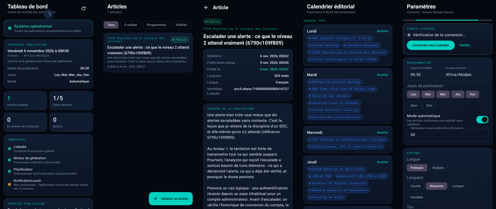

# CyberPost AI

**Assistant intelligent de publication professionnelle sur LinkedIn spécialisé en cybersécurité.**

CyberPost AI génère chaque jour ouvré un article original de cybersécurité et le publie automatiquement sur votre
profil LinkedIn **du lundi au vendredi à 06h30, heure d'Abidjan**. L'application Android sert de console : tableau de
bord, gestion des articles, calendrier éditorial, alertes et paramètres. Toute l'automatisation tourne sur un serveur,
**même lorsque le téléphone est éteint**.

| | |
|---|---|
| Application Android | Kotlin, Jetpack Compose, Material 3, MVVM, Retrofit, Coroutines, Room, Firebase Cloud Messaging |
| Backend | PHP 8.3, Laravel 13, API REST (Sanctum), MySQL, Laravel Scheduler (cron), verrous anti-doublon |
| LinkedIn | API officielle uniquement : OAuth 2.0, OpenID Connect, API Posts (`w_member_social`) |
| Génération | fournisseur configurable (Anthropic, OpenAI, tout service compatible), contrôle qualité automatique |



## Sommaire

1. [Fonctionnalités](#fonctionnalités)
2. [Contenu du dépôt](#contenu-du-dépôt)
3. [Démarrage rapide](#démarrage-rapide)
4. [Installer l'APK](#installer-lapk)
5. [Compiler l'application](#compiler-lapplication)
6. [Utilisation](#utilisation)
7. [Fiabilité de la publication](#fiabilité-de-la-publication)
8. [Tests](#tests)
9. [Limites et points d'attention](#limites-et-points-dattention)
10. [Documentation détaillée](#documentation-détaillée)

## Fonctionnalités

- **Publication automatique** à 06h30 (Africa/Abidjan), du lundi au vendredi, jamais le week-end ; heure, jours et
  fuseau modifiables.
- **Génération** d'un article avant l'heure de publication (60 min par défaut), selon un **calendrier éditorial**
  (lundi SOC et Threat Hunting, mardi Pentest, mercredi actualités, jeudi Cloud et IAM, vendredi carrière, certifications
  et Afrique), avec rotation intelligente et anti-répétition sur 30 jours.
- **24 catégories et 137 angles de sujets** couvrant SOC, Threat Hunting, Incident Response, SIEM, MITRE ATT&CK,
  Pentest, Red/Blue/Purple Team, Active Directory, Malware, Ransomware, Phishing, OSINT, Forensic, Cloud, Zero Trust,
  IAM/PAM, Microsoft 365, EDR/XDR, CVE récentes, APT, réglementation, certifications (CISSP, CEH, CySA+, Security+, CISM,
  CCNA, SC-200, ISO 27001), carrière SOC et cybersécurité en Afrique.
- **Voix éditoriale** de Senior SOC Analyst, à partir de votre **profil éditorial** modifiable ; aucune expérience,
  certification ou anecdote inventée.
- **Contrôle qualité** : question finale, hashtags, longueur, formules artificielles, faits inventés (CVE, chiffres,
  années, sources), similarité avec les 30 derniers jours. Un article douteux n'est jamais publié sans vous.
- **Actualités sourcées** : uniquement à partir du catalogue CISA KEV et des flux CERT-FR (ANSSI), références et dates
  conservées et affichées.
- **Deux modes** : automatique, ou validation (l'article attend votre approbation).
- **Articles** : consulter, lire, modifier, supprimer, régénérer, copier, publier immédiatement, programmer, voir le
  statut et ouvrir le post sur LinkedIn.
- **Tableau de bord** : voyant vert / orange / rouge, état LinkedIn, prochaine publication, statistiques (total,
  semaine), dernière publication, état du moteur de génération, du planificateur et des notifications, erreurs récentes.
- **Notifications** : succès (« CyberPost AI : votre publication du jour a été publiée avec succès sur LinkedIn à 06h30. »),
  échec, jeton expiré ou bientôt expiré, article généré, publication programmée, intervention nécessaire.
- **Paramètres** : heure, jours, fuseau, catégories, longueur, ton, nombre de hashtags, mode, fournisseur, langue
  (français par défaut, anglais), profil éditorial.

## Contenu du dépôt

```
cyberpost-ai/
├── android/                 Application Android (Kotlin, Compose)
├── backend/                 API, ordonnanceur, génération, publication (Laravel 13)
│   ├── database/migrations  Schéma de base de données
│   ├── tests/               56 tests PHPUnit + test de bout en bout (tests/e2e)
│   └── .env.example         Configuration commentée
├── deploy/                  Nginx (HTTPS), crontab, Supervisor
├── dist/                    APK compilé
└── docs/                    Architecture, installation, LinkedIn, génération, notifications, API, tests
```

## Démarrage rapide

1. **Déployer le backend** sur un serveur HTTPS accessible en permanence : [docs/INSTALLATION.md](docs/INSTALLATION.md).
2. **Configurer le cron** (une ligne, indispensable) :
   `* * * * * cd /var/www/cyberpost/backend && php artisan schedule:run >> /dev/null 2>&1`
3. **Créer l'application LinkedIn** (produits « Sign In with LinkedIn using OpenID Connect » et « Share on LinkedIn ») :
   [docs/LINKEDIN.md](docs/LINKEDIN.md).
4. **Renseigner la clé du fournisseur de génération** : [docs/GENERATION.md](docs/GENERATION.md).
5. **Créer votre compte** : `php artisan cyberpost:user:create votre@email`.
6. **Installer l'APK**, saisir l'adresse du serveur, se connecter, puis Paramètres › **Connecter mon LinkedIn**.
7. (Facultatif) **Notifications push** Firebase : [docs/NOTIFICATIONS.md](docs/NOTIFICATIONS.md).

Le tableau de bord passe au **vert** quand LinkedIn, le moteur de génération et le planificateur sont opérationnels.
Tant qu'un service externe n'est pas configuré, son état est affiché clairement : rien n'est simulé.

## Installer l'APK

APK compilé et signé : **`dist/CyberPostAI-1.0.0.apk`** (Android 8.0 et versions ultérieures).

Sur le téléphone : copiez le fichier, ouvrez-le et autorisez l'installation depuis cette source le temps de
l'installation (puis retirez l'autorisation). Au premier lancement, acceptez les notifications.

> L'APK fourni est signé avec une clé de livraison provisoire, générée lors de la compilation et non versionnée.
> Pour publier vos propres mises à jour, créez votre clé de signature (ci-dessous) : une mise à jour signée avec une
> autre clé nécessite de désinstaller la version précédente.

## Compiler l'application

Prérequis : JDK 17 ou plus, Android SDK (plateforme 35, build-tools 35.0.0).

```bash
cd android
echo "sdk.dir=/chemin/vers/android-sdk" > local.properties
./gradlew assembleDebug                 # app/build/outputs/apk/debug/app-debug.apk

# Version signée : créer une clé (une seule fois, à conserver précieusement)
keytool -genkeypair -v -keystore ~/cyberpost-release.jks -alias cyberpost -keyalg RSA -keysize 4096 -validity 10000
cat > keystore.properties <<EOF
storeFile=/home/vous/cyberpost-release.jks
storePassword=...
keyAlias=cyberpost
keyPassword=...
EOF
./gradlew assembleRelease               # app/build/outputs/apk/release/app-release.apk
```

`keystore.properties` et les fichiers `.jks` sont exclus du dépôt.

## Utilisation

- **Tableau de bord** : état global et prochaine publication ; tirer vers le bas pour actualiser.
- **Articles** : filtres (à valider, programmés, publiés, échecs, à vérifier) ; **Générer un article** selon le calendrier
  ou une catégorie précise ; dans un article : Valider, Publier maintenant, Modifier, Programmer, Régénérer, Copier,
  Voir sur LinkedIn, Supprimer.
- **Calendrier** : thèmes de chaque jour et dix prochaines publications.
- **Alertes** : historique des notifications.
- **Paramètres** : connexion LinkedIn, programmation, mode automatique ou validation, contenu, profil éditorial,
  catégories, journal des opérations, déconnexion.

Pour annuler la publication d'un jour donné : passez en mode validation, ou désactivez ce jour, ou programmez
l'article à une autre date. Supprimer l'article du jour avant 06h30 provoque la génération d'un nouvel article.

## Fiabilité de la publication

- L'ordonnanceur du serveur (cron chaque minute) publie à **06h30:00** ; la génération a lieu avant, dans une tâche séparée.
- **Jamais deux fois le même article** : un article par jour (contrainte unique), une publication par article, contenu
  identique refusé, verrou et réservation atomique avant tout appel à LinkedIn.
- **Jamais de double publication en cas de doute** : si LinkedIn ne répond pas clairement (délai dépassé, erreur 5xx,
  serveur interrompu), l'article passe « Vérification nécessaire » ; vous indiquez après contrôle si le post est en
  ligne, aucune nouvelle tentative n'est faite automatiquement.
- **Reprises intelligentes** uniquement lorsque rien n'a pu être créé (connexion impossible, limite 429) :
  2, 5, 10 puis 20 minutes.
- **Publié = confirmé par LinkedIn** (HTTP 201 et identifiant du post enregistré).
- Serveur arrêté à 06h30 : rattrapage dans les 2 heures ; au-delà, notification et attente de votre décision.

Détails : [docs/ARCHITECTURE.md](docs/ARCHITECTURE.md).

## Tests

| Suite | Résultat |
|---|---|
| Backend PHPUnit (SQLite et MariaDB 10.11) | **56 tests, 229 assertions** réussis |
| Bout en bout (backend réel, OAuth complet, simulateur LinkedIn) | **réussi** : génération 05h30, publication 06h30, aucun doublon après redémarrage, rien le week-end |
| Android (JVM, Robolectric) | **22 tests** réussis, dont le rendu des 7 écrans |
| Compilation | APK debug et release (R8, signature v2) |

Procédure complète, y compris la recette avec le vrai LinkedIn : [docs/TESTS.md](docs/TESTS.md).

## Limites et points d'attention

- **Autorisations LinkedIn** : la publication nécessite que LinkedIn accorde à votre application le produit
  « Share on LinkedIn » (`w_member_social`). En cas de refus, l'application l'affiche clairement.
- **Jeton LinkedIn de 60 jours** : sans jeton de rafraîchissement (réservé par LinkedIn à certains partenaires),
  une reconnexion en deux clics est nécessaire environ tous les deux mois ; vous êtes prévenu 7 jours avant.
- **Version de l'API LinkedIn** : `LINKEDIN_API_VERSION=202610` ; à mettre à jour au moins une fois par an
  (une erreur explicite le signale).
- **Clés d'API** : le fournisseur de génération est facturé selon son usage ; la clé reste sur le serveur.
- **Contenus** : le contrôle qualité réduit fortement les risques (faits inventés, répétitions), mais relire vos
  publications reste une bonne pratique ; le mode validation est disponible à tout moment.
- **Non testé ici** : publication sur le vrai LinkedIn, génération avec une vraie clé, téléphone physique, push FCM
  réel (aucun de ces accès n'était disponible dans l'environnement de développement). La procédure de recette
  [docs/TESTS.md](docs/TESTS.md) couvre ces points.

## Documentation détaillée

- [Architecture, base de données, anti-doublon, sécurité](docs/ARCHITECTURE.md)
- [Installation et déploiement du backend, cron](docs/INSTALLATION.md)
- [Connexion au LinkedIn Developer Portal](docs/LINKEDIN.md)
- [Fournisseur de génération et charte éditoriale](docs/GENERATION.md)
- [Notifications et Firebase](docs/NOTIFICATIONS.md)
- [Référence de l'API REST](docs/API.md)
- [Procédure de test de bout en bout](docs/TESTS.md)
